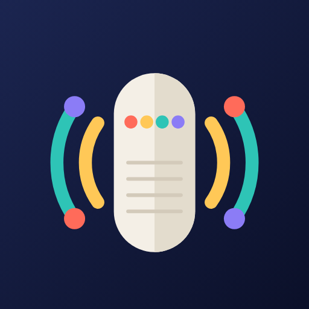

# ISSASPEAKER

A personal command center for Android. It joins the local Google Home speaker, the Google ecosystem
(Sheets, Calendar, Gmail, Drive, Apps Script), music (Spotify, Last.fm), X, books, a Galaxy Watch and AI
models that run on the user's own API keys, so that services that never talk to each other can share one
routine: *at 08:00, read today's birthdays from a sheet, have an AI write the announcement, and say it on
the kitchen speaker.*

**Status:** milestone M0 done (foundation and security baseline); M1 (the MVP) is next. See the
[plan](docs/PLAN.md), the [decisions](docs/DECISIONS.md), the [threat model](docs/security/THREAT-MODEL.md) and the
[feature catalog](docs/FEATURES.md): 432 numbered features, each one marked *implemented*, *to implement*
or *pending*.

## Design choices

- **Android 16+ only** (minSdk 36, target SDK 37). Built for the Galaxy S25 Ultra and the Galaxy Watch 5 Pro;
  older phones are deliberately out of scope.
- Kotlin, Jetpack Compose, Material 3 Expressive.
- Interface in English (default), Latin American Spanish and Brazilian Portuguese; light, dark or phone theme.
- AI on the user's own keys, for any provider: the list comes from a live registry, not a hard-coded one.
- No backend: keys, tokens and history stay on the phone, encrypted.
- The speaker is reached on the local network through Google Cast. Text is turned into speech on the phone.

## Security

Security is a feature here, not an afterthought. The catalog's `SEC` module lists every control and its
state, and the admin About screen shows the same list.

- AI keys encrypted with Android Keystore (StrongBox) and Tink; encrypted local database; nothing secret
  in backups or logs.
- Google access is least-privilege and incremental: each scope is requested when its integration is
  first used, and can be reviewed and revoked in the app.
- Content from mail, sheets, documents and the web is treated as untrusted data. AI output never
  triggers an action without explicit confirmation.
- Supply chain: CodeQL, Dependabot, dependency review and OSV-Scanner, Gradle dependency verification,
  SHA-pinned actions, OpenSSF Scorecard, CODEOWNERS.
- Every finding is logged with an ID in the [audit log](docs/security/AUDIT-LOG.md), including the ones we
  accepted and why.

Found a vulnerability? Please read [SECURITY.md](SECURITY.md) and report it privately.

## Repository map

| Path | What it is |
|---|---|
| `docs/PLAN.md` | Plan, milestones, risks |
| `docs/DECISIONS.md` | Decisions taken and decisions waiting for approval |
| `docs/design/` | Designs: AI provider registry, key vault, UX principles, Play publishing |
| `docs/features/catalog.tsv` | Single source of truth for features |
| `docs/security/` | Threat model, audit log, findings |
| `docs/FEATURES.md` | Generated catalog (`python tools/features.py`) |
| `CLAUDE.md` | Rules for AI coding sessions on this repo |
| `.claude/skills/` | Project skills shared by local and cloud sessions |

Maintained by ISSASODA.
