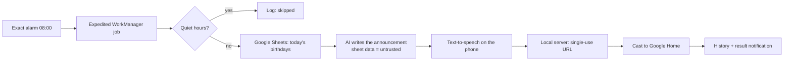

# ISSASPEAKER — Project plan

**Updated:** 2026-10-12 · **Status:** M0 done; M1 next (waiting on CIO decisions C1–C4) · **Owner:** ISSASODA
(sat.tecnologias@gmail.com)

ISSASPEAKER is a personal command center for Android. It joins the Google Home speaker on the local network,
the Google ecosystem (Sheets, Calendar, Gmail, Drive, Apps Script), music (Spotify, Last.fm), X, books, the
Galaxy Watch 5 Pro and AI models that run on the user's own keys. It solves fragmentation: one place that
connects services that never talk to each other.

Related documents:

- [`DECISIONS.md`](DECISIONS.md) — decisions taken, and the ones waiting for the CIO.
- [`features/catalog.tsv`](features/catalog.tsv) — the **single source** of the numbered features;
  [`FEATURES.md`](FEATURES.md) is generated from it (`python tools/features.py`).
- [`design/AI-PROVIDERS.md`](design/AI-PROVIDERS.md), [`design/KEY-VAULT.md`](design/KEY-VAULT.md).
- [`security/THREAT-MODEL.md`](security/THREAT-MODEL.md), [`security/AUDIT-LOG.md`](security/AUDIT-LOG.md),
  [`../SECURITY.md`](../SECURITY.md).

---

## 1. Environment

### Local PC

| Item | State | Detail |
|---|---|---|
| Phone | ✅ | Galaxy S25 Ultra (SM-S938B), Android 16 / API 36, One UI 8.5, on ADB |
| IDE | ✅ | Android Studio Rabbit 1 (2026.2.1), JBR 25.0.3 |
| Android SDK | ✅ | Platforms 34–37, build-tools 37.0.0 |
| GitHub CLI | ✅ | Account `Ataraxiainc2`. Windows Credential Manager hung on a push; push with `git -c credential.helper= -c "credential.helper=!gh auth git-credential" push` |
| codespell | ✅ | 2.4.1, hash-pinned (`tools/requirements-ci.txt`) |
| Keys | ✅ | `D:\SC\AK` (see its README): `A` for API keys, `issa_keys.py` loader, `play_signing.json` fingerprints. Never in the repository |

### Cloud sessions (claude.ai/code)

A cloud session clones this repository on a clean Linux machine.

| Requirement | State | Detail |
|---|---|---|
| Repository | ✅ | `Ataraxiainc2/ISSASPEAKER`, public |
| Claude GitHub App access | ❓ | CIO check C13 |
| Android SDK | ✅ | `tools/cloud/setup-android.sh` via the SessionStart hook; runs only when `CLAUDE_CODE_REMOTE=true`; checksum verified |
| Network | ❓ | The environment must allow `dl.google.com`, `maven.google.com`, `services.gradle.org`, `plugins.gradle.org`, `repo.maven.apache.org`, `pypi.org` |
| Project rules and skills | ✅ | `CLAUDE.md` and `.claude/skills/` (the PC's memory does not travel) |

The cloud cannot reach the phone, the speaker (LAN), the signing keys or `D:\SC\AK`. **The cloud writes code
and passes CI; the PC tests on the phone and releases.**

---

## 2. Technical decisions

| Topic | Decision | Why |
|---|---|---|
| Platform | minSdk 36 (Android 16), compile/target SDK 37 | Newest APIs on purpose; the S25 Ultra is on API 36 |
| Language and UI | Kotlin 2.4, Jetpack Compose (BOM 2026.09), Material 3 Expressive (`material3 1.5.0-beta01`) | Same stack as the other ISSASODA apps; Expressive needs 1.5 |
| Architecture | MVVM, `ui / domain / data` per feature, manual dependency injection | Same as the other apps |
| Modules | `:app` now; `:wear` in M5; shared AI/vault library later (C5) | Modules only when they pay off |
| Google | Credential Manager (identity) + `AuthorizationClient` (incremental scopes) + REST over OkHttp | No heavy client libraries; each scope requested when first needed |
| AI | Live provider registry (models.dev) + supplement; OpenAI-compatible client plus native clients ([AI-PROVIDERS.md](design/AI-PROVIDERS.md)) | No fixed provider list (D5) |
| User keys | Key vault: Keystore on the phone, encrypted copy in the user's Drive `appDataFolder`, vault key in Block Store ([KEY-VAULT.md](design/KEY-VAULT.md)) | An app secret in a public APK protects nothing (C3) |
| Speaker | Cast SDK → Default Media Receiver; text-to-speech on the phone; a minimal local server hands the audio to the speaker | Works without a cloud; 192.168.1.12 is a hint, the speaker is discovered |
| Routines | Exact alarm → expedited WorkManager job | WorkManager alone does not guarantee 08:00 under Doze |
| Storage | Room + SQLCipher; SharedPreferences for plain settings; Tink + Keystore (StrongBox) for secrets | Settings are read before the first frame (no theme flash) |
| Backend | None | Smaller attack surface; everything stays on the phone and in the user's own Google account |
| Languages | English (default), Latin American Spanish, Brazilian Portuguese, per-app picker | Owner's choice |
| Fonts | 133 high-legibility Google Fonts; a different family per text role, drawn at every start (D9) | Owner's choice; each family checked on the S25 |
| Theme | Light, dark or phone setting (D10) | Owner's choice |
| License | MIT (D1) | |

### MVP flow (the 08:00 routine)

---

## 3. Milestones

Every milestone ends with CI green, zero warnings (Lint, detekt, Kotlin, codespell) and the catalog updated.

| Milestone | Scope | Features | Exit criterion |
|---|---|---|---|
| **M0** Foundation ✅ | Skeleton, 3 languages, theme modes, random fonts, public and admin About, CI, CodeQL, Scorecard, threat model, audit log, cloud setup | 21 | Done 2026-10-12 |
| **M1** MVP | Google sign-in and scopes, key vault, live AI provider registry, AI chat (text and voice), speaker discovery and TTS, birthdays from Sheets, daily routine, quiet hours, history | 60 | At 08:00 the speaker announces today's birthdays without touching the phone, three days in a row |
| **M2** Daily routines | Weather, calendar, reminders, news, morning and night announcements, voice routines, widget, Quick Settings tile, **X Radar** | 65 | Full morning routine (weather + agenda + birthdays + X Radar brief) |
| **M3** Google productivity | Gmail, Drive, Apps Script, advanced Sheets, several accounts, weekly and monthly reports | 93 | Daily mail summary read aloud |
| **M4** Music | Spotify, Last.fm full history, Shikaka-style statistics, habit insights on the speaker | 63 | A non-obvious insight about the owner's listening, spoken by the speaker |
| **M5** Watch and health | Wear OS companion for the Watch 5 Pro, Health Connect | 27 | A routine started from the watch |
| **M6** Social and reading | Rest of X, books | 45 | |
| **M7** Advanced intelligence | Learning, analysis, extended news, on-device AI, model ranking | 50 | |
| **M8** Experimental | Adaptive routines, shared AI module, agents, household profiles, differentiators | 38 | Only after validating value |
| **M9** Ecosystem | PC companion (authenticated local service), Home Assistant, devices working together, home security, energy | 112 | "Turn on the PC" and a Home Assistant scene, by voice, with the result spoken |

---

## 4. Validation of the original feature list

The original list had 400 entries; checked with a script, not by eye:

1. **Only 397 distinct original IDs.** Three appear twice: 21 (P2 and P4), 242 (P1 and P2) and 320 (P1 and P3).
2. **Three IDs were never assigned:** 259, 261 and 399. ID 400 is in use (P0, "Automations combining services
   and devices").
3. **Merged duplicates:** 230→398, 227→231, 183→4, 170→171, 254→256, 83→44, 242 (P2)→269, 21 (P4)→21.
4. **Parameter-only variants** became one feature each (the `origin` column keeps every original number): news
   categories, X account groups, post translation targets, music by mood or activity, science/technology/math
   explanations, content languages.
5. **Priority changes**, each explained in the catalog note: weekly and monthly reports and Apps Script moved
   from P0 to P1; active-account identity (235) moved from P2 to P0.
6. **Added since:** platform, security, reliability and cost features; X Radar (D3); the live AI registry and
   key vault (D5, C3); theme and fonts (D9, D10); Last.fm history and habit insights (D4).

Result: **426 features** = 358 from the original list + 68 new. Live counts are at the top of
[`FEATURES.md`](FEATURES.md).

---

## 5. Security posture

Aimed at Anthropic's Cyber Verification Program (Defense tier, open to individuals): the repository shows real,
verifiable defensive practice.

- Public policy (`SECURITY.md`) with private vulnerability reporting.
- STRIDE threat model with a data-flow diagram; audit log with IDs `ISP-SEC-NNN`, also shown in the admin screen.
- Supply chain: CodeQL, Dependabot, dependency review, OSV-Scanner, Gradle dependency verification, wrapper
  validation, SHA-pinned actions, hash-pinned Python tools, OpenSSF Scorecard, CODEOWNERS, protected `main`.
- In the app: no permissions until a feature needs one, HTTPS only, no backups of secrets, no logs in release,
  key vault, endpoint pinning for AI keys, prompt-injection guard, least-privilege Google scopes.
- Honest documentation: accepted risks are written down with their reasons.

---

## 6. Risks

| ID | Risk | Mitigation |
|---|---|---|
| R1 | Samsung puts background apps to sleep | Exact alarm + expedited job; battery-optimization guide; admin diagnostics |
| R2 | AI API costs | Monthly cap per provider and usage meter (C15) |
| R3 | The speaker must be on the same Wi-Fi | Cast discovery, retry, clear failure log, no fixed IP |
| R4 | X charges for API reads | X Radar on xAI `x_search` (about USD 5 per 1,000 posts) with a daily cap (C14); sharing and notifications for free. No scraping |
| R5 | Spotify (Feb 2026): development mode needs Premium, max 5 users, fewer endpoints; recommendations closed since Nov 2024 | PKCE; recommendations from Last.fm + AI (C8) |
| R6 | `gmail.readonly` is a restricted scope | Personal use without CASA (C16) |
| R7 | OAuth "Testing" status can expire grants after 7 days | Consent screen "In production", unverified (C2) |
| R8 | Apps Script API needs the same Cloud project and an API-executable deployment | Feasibility test in M3 |
| R9 | Android 16/17 local-network protection | Test in M1 on target SDK 37 |
| R10 | A poisoned AI registry entry could redirect keys | Endpoint pinning (F418) |

---

## 7. Way of working

- Project rules in `CLAUDE.md`; skills in `.claude/skills/`.
- Quality gates: Lint, detekt and Kotlin warnings as errors, codespell, unit tests, catalog check.
- A shipped feature becomes `implemented` in `catalog.tsv` in the same commit; the admin screen reads it.
- Commits in English, small, with the reason. The repository is public: nothing hidden, nothing secret.
