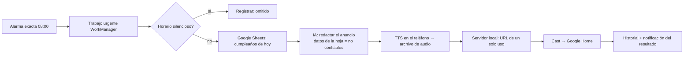

# ISSASPEAKER — Plan del proyecto

**Fecha:** 2026-10-12 · **Estado:** plan propuesto, sin código de la app todavía · **Dueño:** ISSASODA (sat.tecnologias@gmail.com)

ISSASPEAKER es un centro de mando personal para Android: une el parlante Google Home de la red local,
el ecosistema Google (Sheets, Calendar, Gmail, Drive, Apps Script), la música (Spotify, Last.fm),
X, libros, el Galaxy Watch 5 Pro y modelos de IA con las API keys del propio usuario. Resuelve la
fragmentación: un solo lugar que conecta servicios que normalmente no se hablan entre sí.

Documentos relacionados:

- [`docs/features/catalog.tsv`](features/catalog.tsv) — **fuente única** de las 402 características numeradas.
- [`docs/FEATURES.md`](FEATURES.md) — el catálogo legible, generado con `python tools/features.py`.
- [`SECURITY.md`](../SECURITY.md) — política de reporte de vulnerabilidades.

---

## 1. Validación de la configuración

### Local (este PC)

| Elemento | Estado | Detalle |
|---|---|---|
| Carpeta del proyecto | ✅ | `C:\Users\24\AndroidStudioProjects\ISSASPEAKER` (estaba vacía) |
| Teléfono | ✅ | Galaxy S25 Ultra (SM-S938B), **Android 16 / API 36**, One UI 8.5, conectado por ADB |
| Android SDK | ✅ | Plataformas 34–37 y build-tools 37.0.0 instalados |
| JDK | ✅ | `JAVA_HOME` = JBR de Android Studio (OpenJDK 25.0.3); en el `PATH` hay un Java 24 aparte |
| `ANDROID_HOME` | ⚠️ | No está definida; Gradle usará `local.properties` (`sdk.dir`), que Android Studio crea |
| GitHub CLI | ✅ | `gh` 2.102, cuenta `Ataraxiainc2`, permisos `repo` y `workflow` |
| codespell | ❌ | No instalado: `python -m pip install codespell` (mismo uso que EmuGaMind) |
| Skills | ⚠️ | Viven en `~/.claude/skills` (solo este PC). **Copiados al repo** en `.claude/skills/` para que la nube los vea |

### Nube (sesiones de Claude Code en claude.ai/code)

Una sesión en la nube clona el repo de GitHub en una máquina Linux limpia. Lo que eso implica:

| Requisito | Estado | Acción |
|---|---|---|
| Repo en GitHub | ✅ | `Ataraxiainc2/ISSASPEAKER`, público |
| App de GitHub de Claude con acceso al repo | ❓ | Verificar en claude.ai/code → al crear la sesión, elegir el repo; si no aparece, darle acceso a la app |
| Android SDK en la máquina de la nube | ❌ | **M0:** script `tools/cloud/setup-android.sh` + hook `SessionStart` en `.claude/settings.json` que solo corre si `CLAUDE_CODE_REMOTE=true` |
| Red de la nube | ❓ | El entorno debe permitir `dl.google.com`, `maven.google.com`, `services.gradle.org`, `plugins.gradle.org`, `repo.maven.apache.org`. Revisar el nivel de acceso a red del entorno |
| Skills y reglas del proyecto | ✅ | En el repo: `.claude/skills/` y `CLAUDE.md`. La memoria de este PC **no** viaja a la nube |
| Secretos | ✅ | Ninguno en el repo. Las claves de firma siguen en `~/.issasoda-keys` del PC |

**Lo que la nube no puede hacer**, y por tanto se hace en local: instalar en el S25 Ultra, probar el
parlante (192.168.1.12 está en tu LAN), comprobar las Google Fonts en el teléfono real, firmar
releases y probar el inicio de sesión con Google (el SHA-1 de depuración de la nube es otro).
Flujo propuesto: **la nube escribe código y pasa la CI; el PC prueba en el teléfono.**

---

## 2. Decisiones técnicas

| Tema | Decisión | Por qué |
|---|---|---|
| Plataforma | **minSdk 36 (Android 16)**, compile/target SDK 37 | Pediste lo más nuevo aunque deje fuera teléfonos viejos; el S25 Ultra ya está en API 36 |
| Lenguaje y UI | Kotlin 2.4, Jetpack Compose (BOM 2026.09), Material 3 Expressive, Navigation 3 | Mismas versiones que ISSASTUDENT |
| Arquitectura | MVVM + capas `ui / domain / data` por funcionalidad, inyección manual (`AppContainer`) | Igual que tus otras apps; sin Hilt hasta que haga falta |
| Módulos Gradle | `:app` ahora; `:wear` en M5 | Un solo desarrollador: módulos solo cuando aportan |
| Paquete | `com.issasoda.issaspeaker` | Convención ISSASODA |
| Google | Credential Manager (identidad) + `AuthorizationClient` (permisos incrementales) + REST con OkHttp | Sin la librería pesada `google-api-client`; cada permiso se pide cuando se usa |
| IA | REST directo con OkHttp + kotlinx.serialization: **Anthropic Claude, Google Gemini, OpenAI** | Sin SDKs de terceros; el usuario pone sus keys |
| Parlante | Cast SDK (MediaRouter) → *Default Media Receiver*; el texto se convierte a voz en el teléfono (`TextToSpeech.synthesizeToFile`) y un servidor local mínimo le entrega el audio al parlante | Funciona sin nube. 192.168.1.12 queda como pista, el parlante se descubre por la red |
| Rutinas | Alarma exacta → trabajo urgente de WorkManager | **Corrección al PRD:** WorkManager solo no garantiza las 08:00 en punto; con Doze puede atrasarse horas |
| Almacenamiento | Room + SQLCipher; DataStore para preferencias; Tink + Keystore (StrongBox) para las API keys | Igual que ISSASTUDENT, más StrongBox del S25 |
| Backend | **Ninguno en M0–M2** | Menos superficie de ataque; todo vive en el teléfono (ver pregunta D6) |
| Idiomas | Inglés (por defecto), español latinoamericano (`es-419`), portugués de Brasil (`pt-BR`), con selector por app | Lo pediste así |
| Fuentes | Google Fonts descargables (skill `android-google-fonts`) | Regla de ISSASODA; la familia se confirma contigo (D2) |

### Flujo del MVP (rutina de las 08:00)

---

## 3. Hitos

Cada hito termina con la CI en verde, cero advertencias (Lint, detekt, codespell) y el catálogo
actualizado (`status = implemented` en lo que se entregó).

| Hito | Contenido | Características | Criterio de salida |
|---|---|---|---|
| **M0** Cimientos y seguridad base | Esqueleto Compose, 3 idiomas, tema, fuentes, About público y de administrador (generado desde el catálogo), CI, CodeQL, Dependabot, Scorecard, modelo de amenazas, SECURITY.md, configuración de la nube | 18 | La app abre en el S25 en los 3 idiomas; el About de administrador lista lo implementado, lo pendiente y la seguridad; la CI corre en cada push |
| **M1** MVP | Inicio de sesión con Google, permisos y revocación, API keys cifradas, chat de IA (texto y voz), descubrimiento del parlante + TTS, lectura de cumpleaños en Sheets, rutina diaria, horario silencioso, historial, errores | 53 | **A las 08:00 el parlante dice "Hoy es cumpleaños de…" sin tocar el teléfono**, tres días seguidos |
| **M2** Anuncios y rutinas diarias | Clima, calendario, recordatorios, noticias (RSS), anuncios de mañana y noche, rutinas por voz, biblioteca y panel de automatizaciones, widget, mosaico | 55 | Rutina de la mañana completa (clima + agenda + cumpleaños + titulares) |
| **M3** Productividad Google | Gmail, Drive, Apps Script, Sheets avanzado, varias cuentas, informes semanales y mensuales | 93 | Resumen diario de correo leído en voz alta |
| **M4** Música | Spotify, Last.fm, música en Google Home | 56 | Estadísticas de Last.fm y control de Spotify desde la app |
| **M5** Reloj y salud | App Wear OS para el Watch 5 Pro, Health Connect | 27 | Rutina disparada desde el reloj |
| **M6** Social y lectura | X, libros, Shikaka | 50 | Depende de D3 y D4 |
| **M7** Inteligencia avanzada | Aprendizaje, análisis, categorías extendidas de noticias, IA en el teléfono | 49 | — |
| **M8** Experimental | Rutinas adaptativas | 1 | Solo tras validar valor |

---

## 4. Validación del listado de características

El listado original tenía 400 entradas. Hallazgos verificados con un script, no a ojo:

1. **Solo 397 IDs originales distintos.** Tres aparecen dos veces: **21** (P2 y P4), **242** (P1
   "Consulta de correos recientes" y P2 "…y seguimiento") y **320** (P1 "datos curiosos" y P3 "…personalizados").
2. **Tres IDs nunca se asignaron: 259, 261 y 399.** La nota final del listado ("399 únicas + 1 repetida")
   no es correcta, y el ID 400 sí está usado (P0, "Automatizaciones combinando servicios y dispositivos").
3. **Fusiones** de duplicados reales: 230→398, 227→231, 183→4, 170→171, 254→256, 83→44, 242 (P2)→269, 21 (P4)→21.
4. **Variantes de un mismo parámetro** unidas en una sola característica (no se pierde ninguna; el
   origen las lista todas): categorías de noticias (7 en P1, 10 en P3), grupos de cuentas de X (9),
   traducción de publicaciones (4), música por ánimo/actividad (6), explicaciones ciencia/tecnología/matemáticas (3),
   contenido en inglés/español (2, ahora también portugués).
5. **Cambios de prioridad**, cada uno explicado en la nota del catálogo: informes semanales/mensuales y
   Apps Script bajan de P0 a P1 (no son cimientos: dependen de integraciones aún no construidas);
   la identidad de la cuenta activa (235) sube de P2 a P0 (la verificación de administrador la necesita).
6. **La entrada P4 duplicada** se reemplazó por la nueva sugerida: *rutinas adaptativas según patrones históricos de uso*.
7. **44 características nuevas** (plataforma, seguridad, fiabilidad, costos), entre ellas: disparo a hora exacta,
   política de ejecuciones perdidas, tope de gasto de IA, defensa contra inyección de prompts, servidor de audio
   endurecido, widget, mosaico de Ajustes rápidos, Live Updates de Android 16, IA en el teléfono (Gemini Nano).

**Resultado: 402 características** = 358 del listado original + 44 nuevas.
346 por implementar, 12 pendientes de prueba de factibilidad, 44 bloqueadas por una decisión.

---

## 5. Seguridad (lo que el repositorio debe demostrar)

Pensado para la solicitud al Cyber Verification Program de Anthropic (nivel *Defense*, el que admite
personas individuales): el repo muestra práctica defensiva real y verificable, no solo intención.

- **Política pública:** `SECURITY.md` con reporte privado de vulnerabilidades y plazos.
- **Modelo de amenazas** (STRIDE) con diagrama de flujo de datos, en `docs/security/`.
- **Registro de auditoría** con IDs `ISP-SEC-NNN`, el mismo que muestra el About de administrador.
- **Cadena de suministro:** CodeQL, Dependabot, revisión de dependencias, OSV-Scanner, verificación de
  dependencias de Gradle, checksum del wrapper, Actions fijadas por SHA, OpenSSF Scorecard, SBOM por release.
- **En la app:** keys cifradas con Keystore/StrongBox + Tink, base cifrada, biometría, `FLAG_SECURE`,
  sin secretos en copias ni logs, permisos de Google mínimos e incrementales, revocación, servidor de audio
  endurecido, solo HTTPS, y defensa contra inyección de prompts (correos, hojas y publicaciones son datos;
  la IA nunca ejecuta una acción sin confirmación).
- **Honestidad documentada:** el filtro de administrador es de interfaz, no una frontera de seguridad, y así se dice.

---

## 6. Riesgos

| ID | Riesgo | Mitigación |
|---|---|---|
| R1 | Samsung duerme apps en segundo plano | Alarma exacta + trabajo urgente; guía para quitar la optimización de batería; diagnóstico de administrador |
| R2 | Costos de API de IA | Tope mensual por proveedor y medidor de uso (característica nueva) |
| R3 | El parlante debe estar en la misma Wi-Fi | Descubrimiento Cast, reintento, registro claro del fallo, sin IP fija |
| R4 | X cobra por leer | Bloqueado hasta D3; los borradores no necesitan la API |
| R5 | Spotify cerró recomendaciones y artistas relacionados a apps nuevas (nov 2024); controlar la reproducción exige Premium | Recomendaciones con Last.fm + IA |
| R6 | `gmail.readonly` es un permiso restringido | Uso personal en modo de prueba; una publicación abierta exigiría auditoría CASA |
| R7 | En modo *Testing* de OAuth, los permisos pueden caducar a los 7 días | **Validar en M1**; si pasa, mover la pantalla de consentimiento a *In production* sin verificar (uso personal) |
| R8 | Apps Script API exige el mismo proyecto de Cloud y despliegue como "API executable" | Prueba de factibilidad en M3 |
| R9 | Protección de red local de Android 16/17 | Prueba en M1 con target SDK 37 |
| R10 | Shikaka.net: servicio y API sin verificar | Bloqueado hasta D4 |

---

## 7. Forma de trabajo

- **Reglas del proyecto** en `CLAUDE.md` (las lee cualquier sesión, local o en la nube).
- **Skills** en `.claude/skills/`: `android-google-fonts` (fuentes) y `retire-one-shot-scripts` (scripts de un solo uso).
- **Calidad:** Android Lint con advertencias como errores, detekt (mismo `detekt.yml` que ISSASTUDENT/EmuGaMind/ISSAGRAPPH,
  ejecutado con detekt-cli), codespell con lista de palabras en español y portugués, pruebas unitarias. Cero advertencias.
- **Catálogo:** toda característica que se entrega cambia a `implemented` en `catalog.tsv` en el mismo commit;
  el About de administrador se genera desde ahí, así que nunca se desincroniza.
- **Commits** en inglés, pequeños y con el porqué. Nada de código escondido: el repo es público.

---

## 8. Decisiones abiertas (antes de escribir código)

| ID | Pregunta | Recomendación |
|---|---|---|
| D1 | Licencia del repo público | MIT, como ISSASTUDENT y BookCompass |
| D2 | Familias de Google Fonts | Títulos: Space Grotesk · Texto: Atkinson Hyperlegible · Números: JetBrains Mono |
| D3 | X: ¿pagar el acceso de lectura de la API? | Dejarlo bloqueado; hacer solo borradores |
| D4 | ¿Qué es exactamente Shikaka.net y tiene API? | — |
| D5 | Proveedores de IA en M1 | Claude, Gemini y OpenAI |
| D6 | Proyecto de Google Cloud: ¿uno nuevo o el de ISSASODA? ¿Firebase? | Proyecto nuevo `issaspeaker`, sin Firebase |
| D7 | Versión de Wear OS del Watch 5 Pro | Se mira en el reloj antes de M5 |
