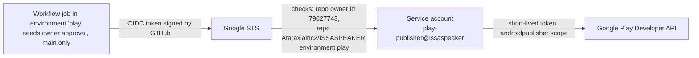

# Publishing to Google Play from GitHub

**Status:** access path built (2026-10-12); waiting for two owner steps (C10, C11).

## How GitHub reaches Google Play without a key

- **Google Cloud project `issaspeaker`:** Workload Identity pool `github`, provider `issaspeaker-repo`
  (issuer `token.actions.githubusercontent.com`), service account `play-publisher`, which holds no keys. The
  only principal allowed to impersonate it is this repository.
- **GitHub:** environment `play` with a required reviewer (the owner) and a deployment rule for `main` only.
  Workflow: `.github/workflows/play.yml`.
- **Why keyless:** a leaked JSON key works from anywhere until someone notices. A federated token lives
  minutes, only exists inside an approved job of this repository, and leaves nothing to steal. This follows
  the direction of Anthropic's CVP requirements (API keys being phased out in favor of workload identity).

## Owner steps still needed

1. **Invite the service account in Play Console** (Users and permissions → Invite new users):
   `play-publisher@issaspeaker.iam.gserviceaccount.com`. Recommended permissions, per app: *View app
   information*, *Release to testing tracks*. Not "Release to production" and not admin: production stays a
   manual decision. My browser session was refused this step, correctly, because it grants account access.
2. **Create the ISSASPEAKER app in Play Console** (C11). The Play API cannot create apps, and the first
   bundle must be uploaded by hand.

Then run *Actions → Google Play → Run workflow*; it should print "Play access OK".

## Releases (next)

A release job will build the bundle, sign it with the upload key from the `play` environment's secrets and
send it to the internal track. Signing in CI means the upload key lives in GitHub secrets; it can be reset in
Play Console if it ever leaks (Play App Signing keeps the real signing key at Google). Until then, releases
are built and signed on the owner's PC (`~/.issasoda-keys/issaspeaker-upload.*`).
