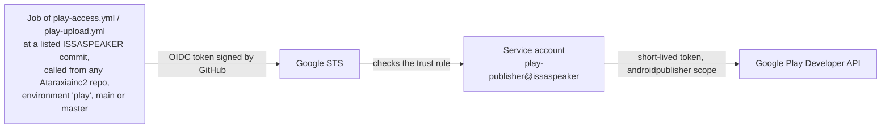
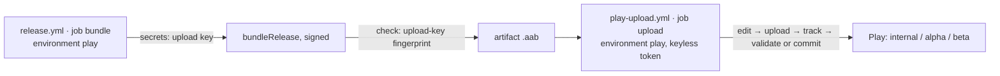

# Publishing to Google Play from GitHub

**Status (2026-10-13):** keyless access working for every app of the developer account. ISSASPEAKER is in Play
Console (internal testing, version 0.1.0). Release pipeline (`release.yml` + `play-upload.yml`) working: the first
dry run built, signed and validated version 0.1.1 (2) for the internal track and discarded it.

## How GitHub reaches Google Play without a key

- **Google Cloud project `issaspeaker`:** Workload Identity pool `github`, provider `issaspeaker-repo`, service
  account `play-publisher` with no keys. Trust rule (set with `tools/play/trust-rule.sh`):
  `repository_owner_id == 79027743 && environment == 'play' && ref in [refs/heads/main, refs/heads/master]
  && job_workflow_ref is ISSASPEAKER's play-access.yml or play-upload.yml && job_workflow_sha in [pinned commits]`.
  It covers every current and future repository of the account. Because of the last two checks, the token
  exists only inside those two reviewed files at a pinned commit: a job written in an app repository cannot
  get one, even in the `play` environment, and a change to ISSASPEAKER's `main` does not reach Play until the
  owner pins it in Google Cloud.
- **Play Console:** the service account is an account-level user (all apps, including future ones) with every
  permission except **Admin**, **Release to production** and **Manage orders and subscriptions**. Production
  stays a manual decision; no automation can move money.
- **GitHub:** each app repository has an environment `play` limited to its default branch. ISSASPEAKER (public)
  also requires the owner's approval for every job. GitHub offers required reviewers on private repositories
  only with a paid plan, so the private app repositories rely on the branch rules (GitHub and Google) and on
  the release workflow being manual.
- **Callers:** EmuGaMind, ISSAGRAPPH, ISSASTUDENT and BookCompass call `play-access.yml` from their own
  `.github/workflows/play.yml`, pinned to a commit SHA. New repository: `bash tools/play/enable-repo.sh <name>`.
- **Why keyless:** a leaked JSON key works from anywhere until someone notices. A federated token lives
  minutes, exists only inside pinned code of these repositories, and leaves nothing to steal.

## Changing play-access.yml or play-upload.yml

1. Commit and push the change; note the new commit SHA.
2. `bash tools/play/trust-rule.sh <new SHA> <old SHA>` (owner's gcloud login) — both accepted during the move.
3. Point every caller (`play.yml`, `release.yml` in each repository) at the new SHA; run them.
4. `bash tools/play/trust-rule.sh <new SHA>` — the old commit is no longer trusted.

## Releases to testing tracks

- **Manual only** (`workflow_dispatch`), from the default branch. Running it is the owner's approval; nothing
  goes to Play otherwise. `dry_run` is on by default: the bundle is uploaded into an edit, validated by Google
  and discarded.
- **Signing:** Workload Identity gives Play access but cannot sign, so the upload key is needed in CI. The
  keystore (base64) and its passwords are secrets of the repository's `play` environment, never
  repository-level: `UPLOAD_KEYSTORE_B64`, `UPLOAD_STORE_PASSWORD`, `UPLOAD_KEY_ALIAS`, `UPLOAD_KEY_PASSWORD`.
  The key is written to the runner's temp folder for the build and removed right after. The job then checks
  that the bundle carries the expected upload-key fingerprint.
- **Separation:** the build job holds the upload key but no Play token; the upload job holds the Play token but
  never the key.
- **Production:** `play-upload.yml` refuses the `production` track and the service account has no production
  right. Promotion to production is a manual step in Play Console.
- **If an upload key leaks:** reset it in Play Console → App signing (Play App Signing keeps the real signing
  key at Google), then replace the secrets.
- **Secrets:** the owner runs `bash tools/play/set-release-secrets.sh [repository]`, which copies each app's upload
  key, `google-services.json` and extra build inputs from the PC into its `play` environment.
- **Master copy of the keys:** the owner's PC, `D:\SC\AK\signing\<app>-upload.jks` + `.properties`. Local release
  builds read it there (`-Pissa.signingDir` or `ISSASODA_SIGNING_DIR` to override).

## Apps (2026-10-13)

| Repository | Package | `play.yml` | `release.yml` | Release inputs beyond the upload key | Local build reads `D:\SC\AK\signing` |
|---|---|---|---|---|---|
| ISSASPEAKER | issaspeaker | pinned, OK | dry run passed | none | yes |
| ISSASTUDENT | issastudent | pinned, OK | added | `google-services.json` | yes |
| BookCompass | bookcompass | pinned, OK | added | `google-services.json`, Google Books key | yes |
| EmuGaMind | emugamind | pinned, OK | added | `google-services.json`, `ADMIN_UID` | its session migrates |
| ISSAGRAPPH | issagrapph | pinned, OK | added | `google-services.json` | its session migrates; GitHub copy is behind the PC |
| — | movierecommendationapp | no repository | — | upload key lost: reset in Play Console first | — |

## Play review access

Google's reviewers can use every ISSASPEAKER feature without signing in today (App access: no restrictions).
When a feature needs a Google account, App access will give the owner's dedicated review account, whose
address is kept with the owner's keys, not in this repository.
