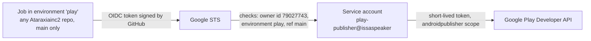

# Publishing to Google Play from GitHub

**Status:** access working for every app of the developer account (2026-10-13). ISSASPEAKER itself still has
to be created in Play Console (C11).

## How GitHub reaches Google Play without a key

- **Google Cloud project `issaspeaker`:** Workload Identity pool `github`, provider `issaspeaker-repo`, service
  account `play-publisher` with no keys. Trust rule:
  `repository_owner_id == 79027743 && environment == 'play' && ref == refs/heads/main`. It covers every
  current and future repository of the account, and nothing else.
- **Play Console:** the service account is an account-level user (all apps, including future ones) with every
  permission except **Admin**, **Release to production** and **Manage orders and subscriptions**. Production
  stays a manual decision; no automation can move money.
- **GitHub:** each app repository has an environment `play` limited to `main`. ISSASPEAKER (public) also
  requires the owner's approval for every run. GitHub offers required reviewers on private repositories only
  with a paid plan, so the private app repositories rely on the `main`-only rules (GitHub and Google).
- **Reusable workflow:** `.github/workflows/play-access.yml` in this public repository. Another repository calls
  it with a few lines (see the header of that file). New repository: `bash tools/play/enable-repo.sh <name>`.
- **Why keyless:** a leaked JSON key works from anywhere until someone notices. A federated token lives
  minutes, exists only inside a job of these repositories on `main`, and leaves nothing to steal.

## Releases (next)

A release job will build the bundle, sign it with the app's upload key from the `play` environment's secrets
and send it to the internal track. The upload key can be reset in Play Console if it ever leaks (Play App
Signing keeps the real signing key at Google). Until then, releases are signed on the owner's PC
(`~/.issasoda-keys`).
